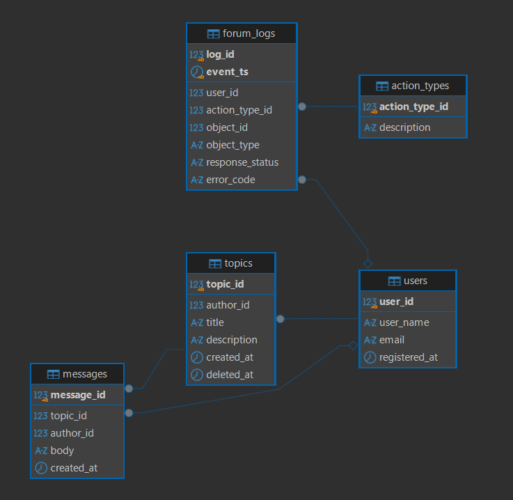

# Инструкция по запуску проекта

## Установка

Если на вашей машине ОС windows, то предварительно необходимо установить [git](https://git-scm.com/install/windows), а так же [Docker](https://docs.docker.com/desktop/setup/install/windows-install/)


## Клонирование репозитория

Создайте папку в которую склонируете проект. Выполните `git clone ...`

Затем перейдите в директорию с проектом, в ней дополнительно нужно создать папки *logs*, *config*, *plugins*

Это можно сделать командой 
```bash
mkdir logs config plugins data
```

Также в корне проекта необходимо добавить файл `.env`
в котором прописать следующие переменные

```
AIRFLOW_UID=

POSTGRESQL_USER=
POSTGRESQL_PASSWORD=
POSTGRESQL_DB=
```

То, что относится к postgresql можно прописать произвольно, при помощи этих кредов вы будете подключаться к БД. Порт для подключение к БД: `5433`

А параметр `AIRFLOW_UID` можно получить введя в баше комманду:
```bash
id -u
```

## Запуск проекта

Перед первым запуском необходимо инициализировать базу данных и создать администратора.

Это делается при помощи команды: 
```bash
docker compose up airflow-init
```

В дальнейшем для запуска всех сервисов необходимо только выполнять команду 
```bash
docker compose up -d
```

# Описание проекта

Основные части проекта, это генерация данных, представляющих собой логи, и сбор некоторой информации (статистики) на основе этих данных.

## ER диаграмма БД


## DDL и DML операции для создания схемы

Эти операции необходимо выполнить последовательно чтобы сформировать архитектуру БД с которой мы будем работать

```sql
create table if not exists  users (
	user_id bigserial primary key,
	user_name varchar(256) unique not null,
	email varchar(254) unique, -- максимальная длинна электронной почты 254 символа
	registered_at timestamp not null
)

create table if not exists  topics (
	topic_id bigserial primary key,
	author_id bigint not null references users(user_id),
	title varchar(512) not null,
	description text,
	created_at timestamp not null,
	deleted_at timestamp
);

create table if not exists  messages (
	message_id bigserial primary key,
	topic_id bigint not null references topics(topic_id),
	author_id bigint references users(user_id),
	body text,
	created_at timestamp not null
);

create table if not exists action_types (
	action_type_id smallserial primary key,
	description varchar(256) unique not null
);

create table if not exists forum_logs (
  log_id         bigserial,
  event_ts       timestamp not null,
  user_id        bigint  references users(user_id),
  action_type_id smallint not null references action_types(action_type_id),
  object_id      bigint,
  object_type    varchar(256),
  response_status varchar(256) not null, 
  error_code     varchar(256),     
  PRIMARY KEY (event_ts, log_id)
) PARTITION BY RANGE (event_ts)
```

Затем нужно вставить данные которые мы будем считать неизменяемыми, это данные о типах действия пользователя

```sql
insert into action_types values 
(1, 'FIRST_VISIT'),
(2, 'REGISTER'),
(3, 'LOGIN'),
(4, 'LOGOUT'),
(5, 'CREATE_TOPIC'),
(6, 'ENTRY_TOPIC'),
(7, 'DELETE_TOPIC'),
(8, 'CREATE_MESSAGE')
```

## DAG генерации данных
Для генерации был реализован DAG `forum_data_generation`, который реализует генирацию всех необходимых по ТЗ логов, учитывая прописанные ограничения. Затем происзодит валидацию данных.
А после чего их загрузку в БД.

Этап генерации, постарался реализовать максимально приближенно к реальному представлению настоящих логов, а именно, чтобы авторизованный пользователь мог выполнять действия только в моменты залогиненного состояния, чтобы сообщения на Теме можно было оставлять только в период существования темы и т. д.

Сделал небольшой этап валидации данных, на соответствие типам данных, на соответствие вхождению данных в множество значений, а так же некоторые логические валидации по типу проверки, были ли логауты пользователей без логина.

Затем реализовал загрузку полученных логов поэтапно в соответсвующие таблицы в БД. А так же реализовал предварительное создание помесячных партиций, для основной таблицы с логами.

Даг запускается вручную, так же при запуске мы можем передать через **Airflow Params** год и месяц, за который нужно сгенерировать данные.

В этом DAG-е я реализовал передачу данных напрямую через XCom, так как генерирую относительно небольшое количество логов (сделал так, поскольку это тестовое задание), при реальных же данных с большим масштабом, так конечно же делать нельзя, так как будет перегружена БД метаданных Airflow. Лучше передавать, через XCom ссылку с путем к данным.

## DAG агрегации данных

После успешной обработки DAG-a в папке data/ будет создаваться .csv файл с необходимой статистикой.

## Партиционирование
Для таблицы логов решил создавать помесячные партиции данных. При таком выборе диапазонов партиционирования, даже за несколько лет количество партиций не разрастется слишком сильно, но при этом данные будут обладать значительным эффектом отсечения.

Но я ни в коем случае не утверждаю, что данный выбор единственно верный, в реальности же лучше все же проанализировать свои объемы данных и выполняемые на них задачи, для того чтобы подобрать наиболее эффективный период партиционирования.

Может быть в реальности вообще лучшим выбором станет комбинированное партиционирование где данные к примеру разбиваются по месяцам, а затем делятся на партиции по типам логов (если мы предварительно понимаем, что этих типов достаточно малое количество, чтобы не плодить много партиций, а так же что типы логов делять все множество логов примерно на равные части, потому что если один тип логов занимает 99% процентов всей выборки, а остальные типы 1%, то смысла в таком партиционировании нет).

А так как это тестовое задание, наиболее подходящим на мой взгляд для общего случая будет помесячное партиционирование.

## Индексы
Основным элементом задания являются логи, из-за чего мы можем смело предположить, что для таблицы с логами будет очень много операций вставки.

Из-за чего создание большого количества индексов, сильно замедлит работу с таблицей, так как по мимо вставки самой строки придется обновлять все созданные индексы. А судя по ТЗ статистика по данным будет собираться раз в день (либо ручным запуском, что тоже не часто).

Из-за чего мы понимаем, что над таблицей будут преобладать DML операции (наверное в основном insert), а не DQL, а это очевидный антипатерн для создания индексов.

Также исходя из ТЗ можно заметить, что из БД мы вытягиваем сырые логи, а статистику собираем уже при помощи python, из-за чего нам в целом не понадобятся индексы для таблицы с логами.

Так что в данном задании можно обойтись только автоматически созданными индексами. Допольнительных добавлять нет необходимости.

Так же хотел бы уточнить почему я сделал составной PK для таблицы forum_logs, поле `event_ts` в целом может быть не уникально, но вместе с log_id эта проблема отпадает, так же поле `event_ts` стоит на первом месте в PK, так как автоматически созданный индекс по комбинации полей (`event_ts`, `log_id`) в этом случае будет лучше работать для sql запросов реализованных в задании, так как фильтрация происходит именно по полю `event_ts`.